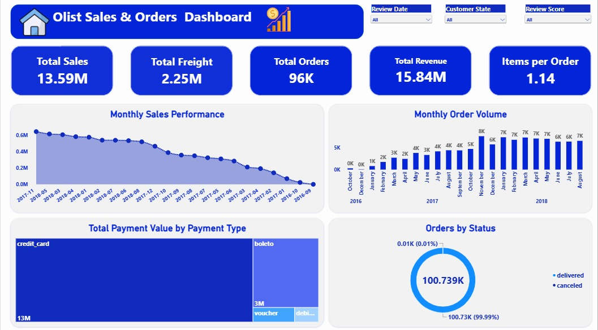
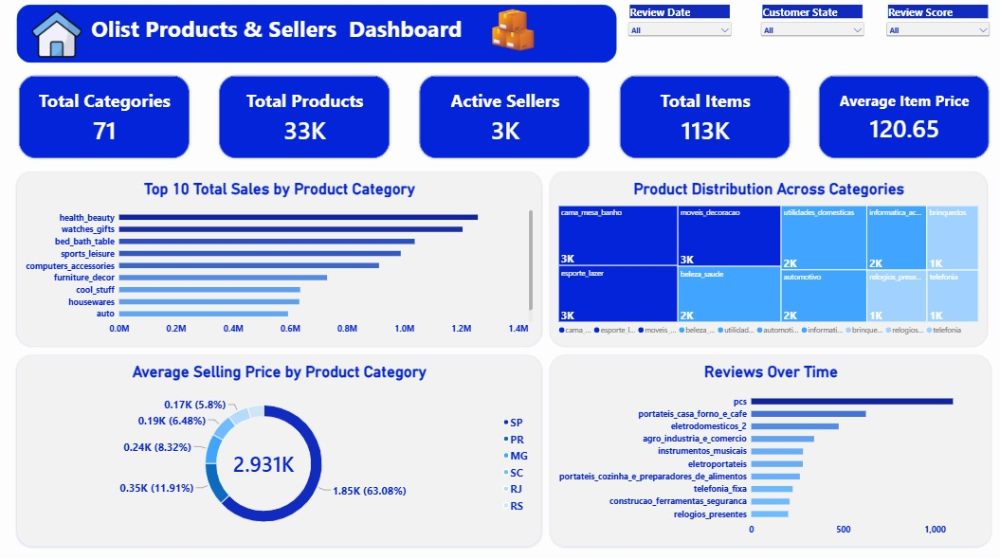
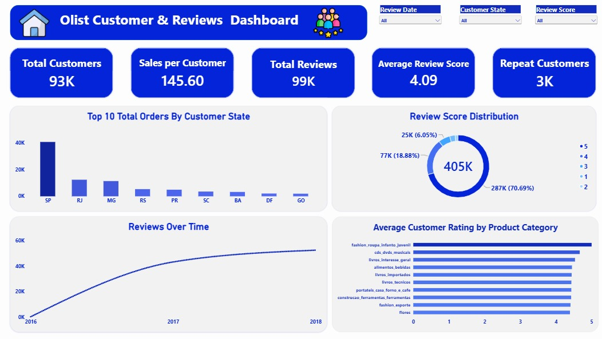

# Olist E-commerce Sales Analysis

Interactive multi-page Power BI report analyzing the Brazilian Olist e-commerce public dataset: sales, orders, delivery, products, sellers, and customer reviews.

## Dashboard Preview

### Sales & Orders

### Products & Sellers

### Customer & Reviews

## Dataset
[Brazilian E-Commerce Public Dataset by Olist](https://www.kaggle.com/datasets/olistbr/brazilian-ecommerce) (Kaggle): about 100k orders placed at multiple marketplaces in Brazil between 2016 and 2018.

## Report Pages
- **Home**: navigation and overview
- **Sales & Orders**: revenue, freight, orders, monthly trends, payment types, order status
- **Products & Sellers**: category and seller analysis
- **Customer & Reviews**: customer behavior and satisfaction

## Data Model
Built on the Olist public datasets: orders, order items, order payments, order reviews, customers, sellers. Includes a `_Measures` table with 50 DAX measures (sales, freight, orders, delivery, customers, products, payments, reviews, YoY/MoM time intelligence) and a `Dim_Date` calendar table.

## Dashboard Highlights
Figures as shown on the report's own pages:
- 96K orders, 93K customers, about 3K active sellers, 113K items sold across 71 product categories.
- Total revenue of 15.84M; credit card is the largest payment type (about 13M), followed by boleto (about 3M).
- Monthly order volume grows from 2016 through 2017 and peaks at about 8K orders in November 2017.
- Top categories by sales: health_beauty, watches_gifts and bed_bath_table.
- São Paulo (SP) has the most orders of any customer state.
- Average review score is 4.09, and 70.69% of reviews are 5 stars.

## Tools
- Microsoft Power BI Desktop (enhanced report format, PBIR)
- DAX

## Download
The full report (`olist-ecommerce-sales-analysis.pbix`) is in [Releases](../../releases), split into 2 parts (`.pbix.001` and `.pbix.002`) because of GitHub's upload size limit. The screenshots above show every page, so you do not need to download it to see the work.

To rebuild it:
1. Download both parts into the same folder
2. Join them, either:
   - Windows Command Prompt: `copy /b olist-ecommerce-sales-analysis.pbix.001+olist-ecommerce-sales-analysis.pbix.002 olist-ecommerce-sales-analysis.pbix`
   - or open the `.001` file with 7-Zip and extract
3. Open `olist-ecommerce-sales-analysis.pbix` in Power BI Desktop (Windows only)
